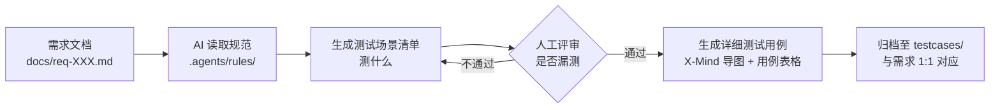

# AI-Test-Case-Agent（测试用例自动化生成工作流）

> 基于 Claude Code + 本地文件系统搭建的测试用例生成框架：将《测试用例编写规范》固化为 Agent 的 System Rules，实现从「需求文档」到「结构化测试用例」的半自动化流转。

## 核心理念

- **规范先行**：规范即硬约束。把用例编写标准沉淀为独立规则文件，强制约束大模型输出格式与覆盖要求，避免输出标准不统一。
- **先发散后收敛**：优先产出「测试场景清单」（明确测什么）→ 人工评审校验 → 再生成「详细测试用例」（明确怎么测），通过人工卡点降低 AI 幻觉、漏测风险。
- **资产可追溯**：需求库（`docs/`）与用例库（`testcases/`）采用 1:1 目录映射，方便归档、复盘与版本追溯。

## 工作流程



## 目录结构

```text
claude_project/
├── README.md                          # 项目说明与使用指南
├── .agents/
│   └── rules/
│       └── 01-测试用例编写规范.md      # 核心：给 AI 读取的强制约束规则
├── .claude/                           # Claude Code 全局配置
├── docs/                              # 原始需求库
│   ├── req-001-登录模块.md
│   └── req-002-AI填充商品标题.md
└── testcases/                         # 测试用例资产库（和需求一一对应）
    ├── req-001-登录模块/
    │   ├── 测试场景清单.md            # 评审阶段：提取测试点
    │   └── 测试用例.md                # 执行阶段：思维导图 + 用例表格
    └── req-002-AI填充商品标题/
        ├── 测试场景清单.md
        └── 测试用例.md
```

## 快速开始

1. 将需求文档以 Markdown 格式编写，按 `req-XXX-功能名.md` 命名，放入 `docs/` 目录；
2. VS Code 打开项目，唤起 Claude Code 终端；
3. 下发以下指令：

```text
作为测试助手，请自动读取 docs/ 目录下的所有需求文档。
对于每一个需求，在 testcases/ 目录下检查是否存在同名文件夹。
如果没有，请创建。
然后严格按照 .agents/rules/01-测试用例编写规范.md 的要求，
为每个需求生成『测试场景清单.md』和『测试用例.md』
（包含 X-Mind 导图和详细表格），并直接写入对应文件夹中。
```

## 规范约定

### 命名约定

| 类型 | 规则 | 示例 |
| ---- | ---- | ---- |
| 需求文档 | `req-XXX-功能名.md`（三位数字递增） | `req-001-登录模块.md` |
| 测试目录 | 与需求文档同名 | `req-001-登录模块/` |
| 测试文档 | 固定文件名 | `测试场景清单.md`、`测试用例.md` |

### 用例层级规范（适配 X-Mind）

1. **菜单模块**（对应系统菜单）
2. **子模块 / 页面**（对应具体页面）
3. **功能域**（筛选条件、列表校验、操作按钮等）
4. **测试点**（单个功能校验项）
5. **测试详情**（前置条件、测试步骤、期望输出、用例编号、优先级）

### 输出格式要求

每份用例文件必须同时输出两种形式：

- **X-Mind 风格 Markdown 思维导图**：用于评审梳理
- **Markdown 表格**：可直接导入测试管理平台执行

完整细则见：[`.agents/rules/01-测试用例编写规范.md`](.agents/rules/01-测试用例编写规范.md)

## 规则文件示例（节选）

`01-测试用例编写规范.md` 的核心约束：

```markdown
## AI 强制执行指令（最高优先级）

1. 先分类，后展开：涉及不同角色/状态的需求，必须先作为二级分类节点，
   再往下拆解测试点。严禁流水账式铺陈。
2. 拒绝正向自嗨：每个三级功能点，必须独立产出至少 1 条正向用例
   + 至少 1 条异常/边界用例；正向、异常不能合并在同一条用例内。
3. 禁止模糊断言：预期结果禁止出现「系统正常」「功能可用」等词汇，
   必须写明具体提示语、页面状态、跳转地址或接口返回码。
```

配套覆盖维度：必填为空与格式非法、无权限穿透（URL 直访 / 越权调接口）、状态边界（长度与日期极值）、并发与重复提交、依赖数据不存在。

## 最佳实践与边界

| 场景 | 建议 |
| ---- | ---- |
| 增删改查（CRUD）类需求、表单字段校验、列表查询等标准化模块 | 适合全流程交由 Agent 生成 |
| 跨系统交互、复杂状态机 | 不建议全自动生成，先人工拆解为子需求，逐个生成 |
| 所有场景 | 严格把关「测试场景清单」阶段，规避 AI 逻辑断层 |

## 背景与定位

本项目的出发点是解决直接让大模型写用例时的三个高频问题：只覆盖正向流程、遗漏权限越权与边界场景、预期结果写成「系统正常」无法执行。

因此在这套工作流中：**规则由人定义，文稿由 AI 生成，评审由人把关**。当前为本地 Markdown 方案，依赖 Claude Code 运行，未对接测试管理平台；后续可扩展方向包括用例质量校验脚本（如自动检测缺失预期结果、优先级）、对接待办系统自动回写等。